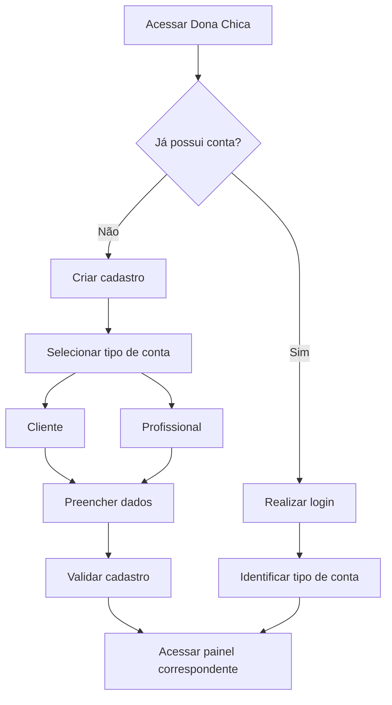
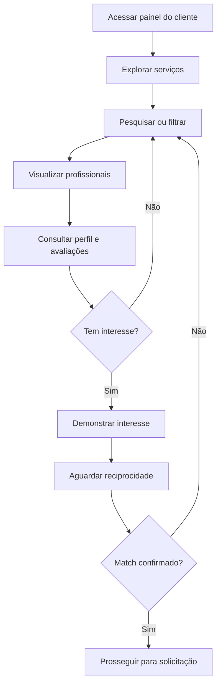
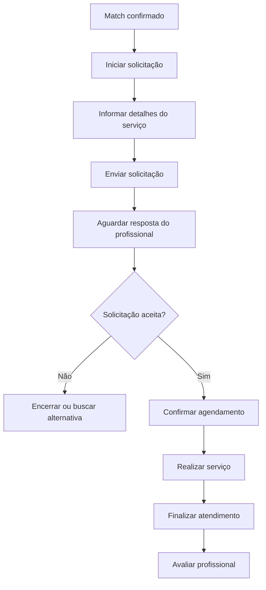
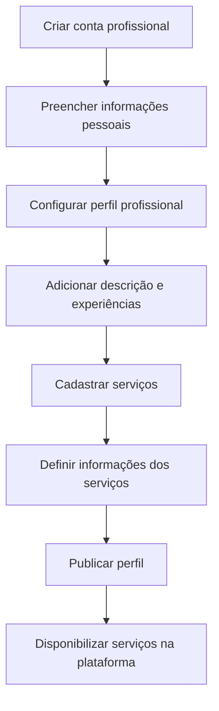
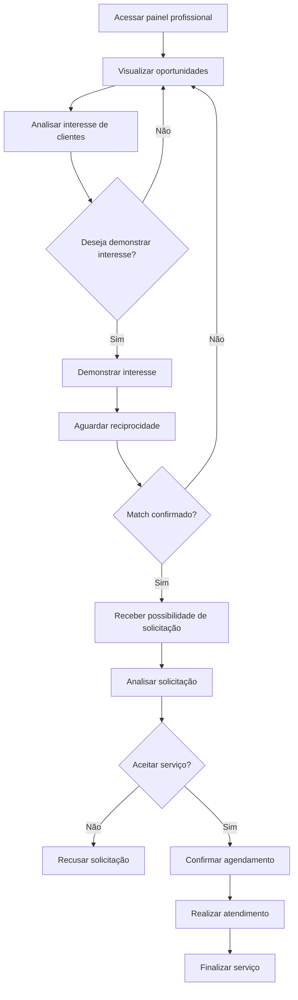
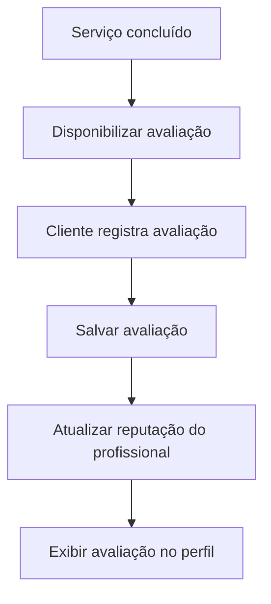
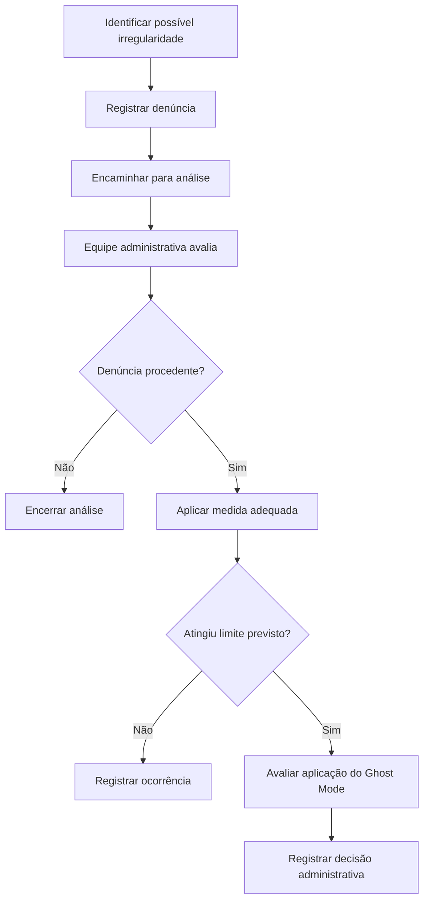

# 08. Fluxos de Usuário — Dona Chica

**Projeto:** Dona Chica  
**Documento:** Fluxos de Usuário  
**Versão:** 1.0  
**Status:** Em desenvolvimento

---

## 1. Objetivo

Este documento apresenta os principais fluxos de utilização da plataforma Dona Chica, descrevendo as etapas percorridas por clientes e profissionais durante a utilização do sistema.

O objetivo é orientar o desenvolvimento das interfaces, funcionalidades e regras de negócio, garantindo uma experiência organizada, intuitiva e coerente com a proposta do produto.

## 2. Tipos de Usuário

A plataforma possui dois tipos principais de conta:

### 2.1 Cliente

Usuário que procura, avalia e solicita serviços disponíveis na plataforma.

Possui um painel próprio para gerenciar suas atividades.

### 2.2 Profissional

Usuário que disponibiliza serviços, administra seu perfil profissional e recebe solicitações de clientes.

Possui um painel independente para gerenciar suas atividades.

**Importante:** cada conta possui um único tipo de acesso. Os painéis de cliente e profissional são distintos.

---

## 3. Fluxo de Cadastro e Acesso

O usuário acessa a plataforma e escolhe criar uma conta ou entrar em uma conta existente.

## 4. Fluxo do Cliente

O cliente utiliza a plataforma para encontrar profissionais, demonstrar interesse e solicitar serviços.

### 4.1 Busca por Serviços

### 4.2 Solicitação de Serviço

---

## 5. Fluxo do Profissional

O profissional utiliza a plataforma para apresentar seus serviços, conquistar clientes e administrar solicitações.

### 5.1 Configuração do Perfil

### 5.2 Recebimento de Oportunidades

---

## 6. Fluxo de Avaliações

Após a conclusão de um atendimento, o cliente poderá avaliar sua experiência.

As avaliações devem contribuir para a transparência e a construção de confiança entre os usuários.

---

## 7. Fluxo de Denúncias e Moderação

A plataforma deverá oferecer mecanismos para que usuários relatem comportamentos inadequados, problemas ou possíveis violações das regras.

O Ghost Mode está previsto nas regras de negócio da plataforma. Sua aplicação deverá considerar a análise das denúncias, a possibilidade de contestação e os critérios de moderação definidos.

O limite de quatro denúncias está previsto no planejamento atual, mas a aplicação de penalidades deverá ser validada antes da implementação.

---

## 8. Fluxo Administrativo

A equipe responsável pela administração deverá possuir acesso a ferramentas de gerenciamento e moderação.

Entre as atividades previstas estão:

- Consultar usuários cadastrados.
- Analisar denúncias.
- Acompanhar avaliações.
- Verificar ocorrências.
- Administrar medidas de moderação.
- Acompanhar a integridade da plataforma.

O acesso administrativo deverá ser restrito e protegido por permissões específicas.

---

## 9. Considerações Gerais

Os fluxos apresentados representam a experiência planejada para a primeira versão da Dona Chica.

Algumas etapas ainda dependem de decisões de produto, especialmente:

- Critérios de formação do Match.
- Regras de aceite e recusa de solicitações.
- Comunicação entre cliente e profissional.
- Cancelamento e reagendamento.
- Processo de verificação de identidade.
- Critérios de análise e contestação de denúncias.

Essas definições deverão ser aprofundadas nos documentos de regras de negócio, arquitetura e documentação técnica.

---

## 10. Relação com Outros Documentos

- `01-visao-do-produto.md` — Visão geral da plataforma.
- `02-pesquisa-de-campo.md` — Resultados da pesquisa com usuários.
- `03-regras-de-negocio.md` — Regras que orientam os fluxos.
- `04-personas.md` — Perfis comportamentais dos usuários.
- `05-requisitos-funcionais.md` — Funcionalidades previstas.
- `06-requisitos-nao-funcionais.md` — Requisitos de qualidade.
- `07-escopo-do-mvp.md` — Limites da primeira versão.

---

**Dona Chica — Documentação do Produto**
