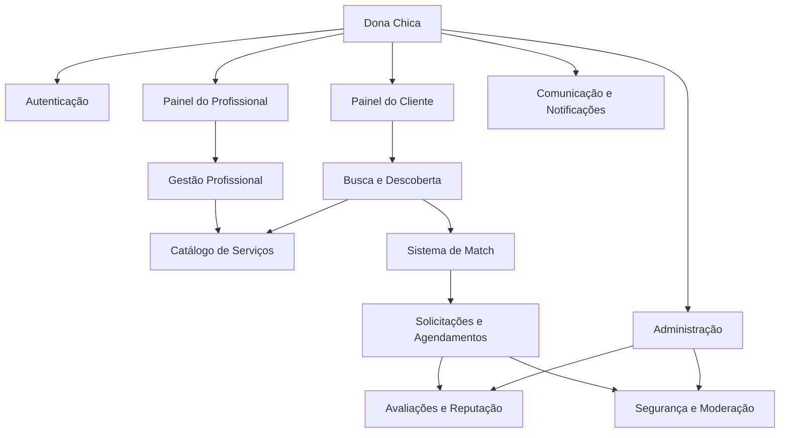

# 09. Arquitetura do Produto — Dona Chica

**Projeto:** Dona Chica  
**Documento:** Arquitetura do Produto  
**Versão:** 1.0  
**Status:** Em desenvolvimento

---

## 1. Objetivo

Este documento apresenta a organização funcional da plataforma Dona Chica, identificando seus principais módulos, responsabilidades e relações.

A arquitetura do produto busca garantir uma estrutura modular, organizada e preparada para futuras expansões, considerando inicialmente uma aplicação web e, posteriormente, um aplicativo Android.

## 2. Visão Geral

A Dona Chica será uma plataforma digital que conecta pessoas interessadas em contratar serviços a profissionais que desejam divulgar e oferecer suas habilidades.

O produto será dividido em módulos independentes, mas integrados entre si.

A primeira versão será disponibilizada como aplicação web responsiva. Em uma etapa posterior, será desenvolvido um aplicativo Android utilizando a mesma estrutura central de dados e serviços.

## 3. Estrutura Geral do Produto

A plataforma será organizada nos seguintes módulos:

1. Autenticação e gerenciamento de contas.
2. Gestão de clientes.
3. Gestão de profissionais.
4. Catálogo de serviços.
5. Busca e descoberta.
6. Sistema de Match.
7. Solicitações e agendamentos.
8. Avaliações e reputação.
9. Segurança e moderação.
10. Administração.
11. Comunicação e notificações.

## 4. Descrição dos Módulos

### 4.1 Autenticação e Gerenciamento de Contas

Responsável pelo cadastro, login, recuperação de acesso e controle de permissões.

Principais responsabilidades:

- Cadastro de clientes.
- Cadastro de profissionais.
- Autenticação de usuários.
- Recuperação de senha.
- Gerenciamento de sessão.
- Controle de permissões por tipo de conta.

### 4.2 Gestão de Clientes

Responsável pelas informações e atividades dos usuários que contratam serviços.

Principais responsabilidades:

- Gerenciamento do perfil.
- Consulta de serviços.
- Acompanhamento de solicitações.
- Gerenciamento de agendamentos.
- Histórico de atendimentos.
- Registro de avaliações e denúncias.

### 4.3 Gestão de Profissionais

Responsável pela apresentação e administração dos perfis profissionais.

Principais responsabilidades:

- Cadastro de informações profissionais.
- Gerenciamento de experiências e habilidades.
- Publicação de serviços.
- Gerenciamento de disponibilidade.
- Acompanhamento de oportunidades.
- Consulta de avaliações e reputação.

Um profissional poderá cadastrar diferentes habilidades e disponibilizar mais de uma categoria de serviço.

### 4.4 Catálogo de Serviços

Responsável pela organização dos serviços disponíveis na plataforma.

Principais responsabilidades:

- Cadastro de categorias.
- Organização dos serviços.
- Descrições e informações dos serviços.
- Associação de serviços aos profissionais.
- Consulta e atualização das informações.

O catálogo deverá permitir categorias variadas, incluindo serviços domésticos, culinária, atividades criativas e serviços religiosos ou esotéricos.

### 4.5 Busca e Descoberta

Responsável por conectar clientes aos profissionais disponíveis.

Principais responsabilidades:

- Pesquisa por serviços.
- Pesquisa por categorias.
- Aplicação de filtros.
- Exibição de profissionais.
- Consulta de perfis.
- Visualização de avaliações.

Os critérios de ordenação e recomendação serão definidos posteriormente.

### 4.6 Sistema de Match

O Match será um dos mecanismos centrais da Dona Chica.

Sua finalidade é estabelecer uma conexão entre clientes interessados em determinado serviço e profissionais interessados em oferecer seus serviços.

O processo deverá considerar o interesse das duas partes.

**Fluxo conceitual:**

1. O cliente encontra um profissional e demonstra interesse.
2. O profissional também demonstra interesse no cliente ou na oportunidade.
3. O sistema identifica a reciprocidade.
4. Um Match é estabelecido.
5. As partes poderão prosseguir para a etapa de solicitação do serviço.

Os critérios exatos de reciprocidade, visibilidade e funcionamento do Match ainda deverão ser especificados.

### 4.7 Solicitações e Agendamentos

Responsável pelo gerenciamento das contratações e dos atendimentos.

Principais responsabilidades:

- Criação de solicitações.
- Recebimento de solicitações pelo profissional.
- Aceitação ou recusa.
- Definição de data e horário.
- Confirmação de agendamento.
- Acompanhamento do atendimento.
- Finalização do serviço.

### 4.8 Avaliações e Reputação

Responsável pela construção de confiança entre os usuários.

Principais responsabilidades:

- Registro de avaliações.
- Consulta de avaliações recebidas.
- Histórico de reputação.
- Exibição de informações relevantes nos perfis.
- Apoio à tomada de decisão dos usuários.

### 4.9 Segurança e Moderação

Responsável pelos mecanismos de proteção, integridade e acompanhamento de ocorrências.

Principais responsabilidades:

- Registro de denúncias.
- Acompanhamento de ocorrências.
- Verificação de informações, conforme os procedimentos definidos.
- Análise administrativa.
- Aplicação de medidas de moderação.
- Gerenciamento do Ghost Mode.

A implementação dos mecanismos de verificação e proteção dependerá de decisões técnicas, operacionais e legais.

### 4.10 Administração

Responsável pelo gerenciamento interno da plataforma.

Principais responsabilidades:

- Consulta de usuários.
- Gerenciamento de contas.
- Análise de denúncias.
- Acompanhamento de avaliações.
- Moderação de conteúdo.
- Aplicação e acompanhamento de medidas administrativas.

O módulo deverá possuir acesso restrito e permissões específicas.

### 4.11 Comunicação e Notificações

Responsável por informar os usuários sobre eventos importantes da plataforma.

Possíveis notificações:

- Novas solicitações.
- Atualizações de agendamentos.
- Confirmações de Match.
- Alterações no status de serviços.
- Avaliações.
- Comunicados administrativos.

Os canais de comunicação e os recursos de mensagens ainda serão definidos. A comunicação em tempo real não faz parte do escopo inicial previsto para o MVP.

---

## 5. Relação entre os Módulos

Os módulos deverão funcionar de maneira integrada.

Exemplo de relacionamento:

- A autenticação identifica o usuário e determina seu tipo de conta.
- A gestão de profissionais disponibiliza informações ao catálogo.
- A busca consulta o catálogo e apresenta profissionais.
- O Match registra a reciprocidade de interesse.
- As solicitações utilizam o Match como etapa anterior à contratação, conforme as regras definidas.
- Os agendamentos alimentam o histórico de atendimentos.
- As avaliações contribuem para a reputação.
- As denúncias são encaminhadas ao módulo de segurança e moderação.
- A administração acompanha os processos que exigem intervenção.

## 6. Representação Conceitual

## 7. Plataformas e Evolução

### Fase 1 — Aplicação Web

- Interface responsiva.
- Painel do cliente.
- Painel do profissional.
- Área administrativa.
- Integração com a API.
- Persistência de dados.

### Fase 2 — Aplicativo Android

- Desenvolvimento de aplicativo Android.
- Integração com a mesma API central.
- Reutilização das regras de negócio.
- Acesso às funcionalidades principais.
- Adaptação da experiência para dispositivos móveis.

### Fase 3 — Expansão

- Aprimoramento dos módulos existentes.
- Novas funcionalidades.
- Melhorias de desempenho.
- Ampliação dos mecanismos de segurança.
- Novas possibilidades de integração.

## 8. Princípios Arquiteturais do Produto

A organização da Dona Chica deverá considerar:

- **Modularidade:** funcionalidades organizadas por responsabilidades.
- **Escalabilidade:** estrutura preparada para crescimento.
- **Segurança:** proteção das contas e informações dos usuários.
- **Usabilidade:** experiências específicas para clientes e profissionais.
- **Manutenibilidade:** facilidade de atualização e evolução.
- **Integração:** comunicação consistente entre os módulos.
- **Evolução multiplataforma:** possibilidade de expansão da web para Android.

## 9. Pontos Pendentes de Definição

Algumas decisões deverão ser aprofundadas antes da implementação:

- Regras completas do sistema de Match.
- Funcionamento da comunicação entre usuários.
- Critérios de cancelamento e reagendamento.
- Integração de pagamentos.
- Processo de verificação de identidade.
- Funcionamento da localização e do acompanhamento de serviços.
- Critérios técnicos de moderação.
- Canais e prioridades de notificação.

## 10. Relação com Outros Documentos

- `01-visao-do-produto.md`
- `02-pesquisa-de-campo.md`
- `03-regras-de-negocio.md`
- `04-personas.md`
- `05-requisitos-funcionais.md`
- `06-requisitos-nao-funcionais.md`
- `07-escopo-do-mvp.md`
- `08-fluxos-de-usuario.md`

---

**Dona Chica — Documentação do Produto**
