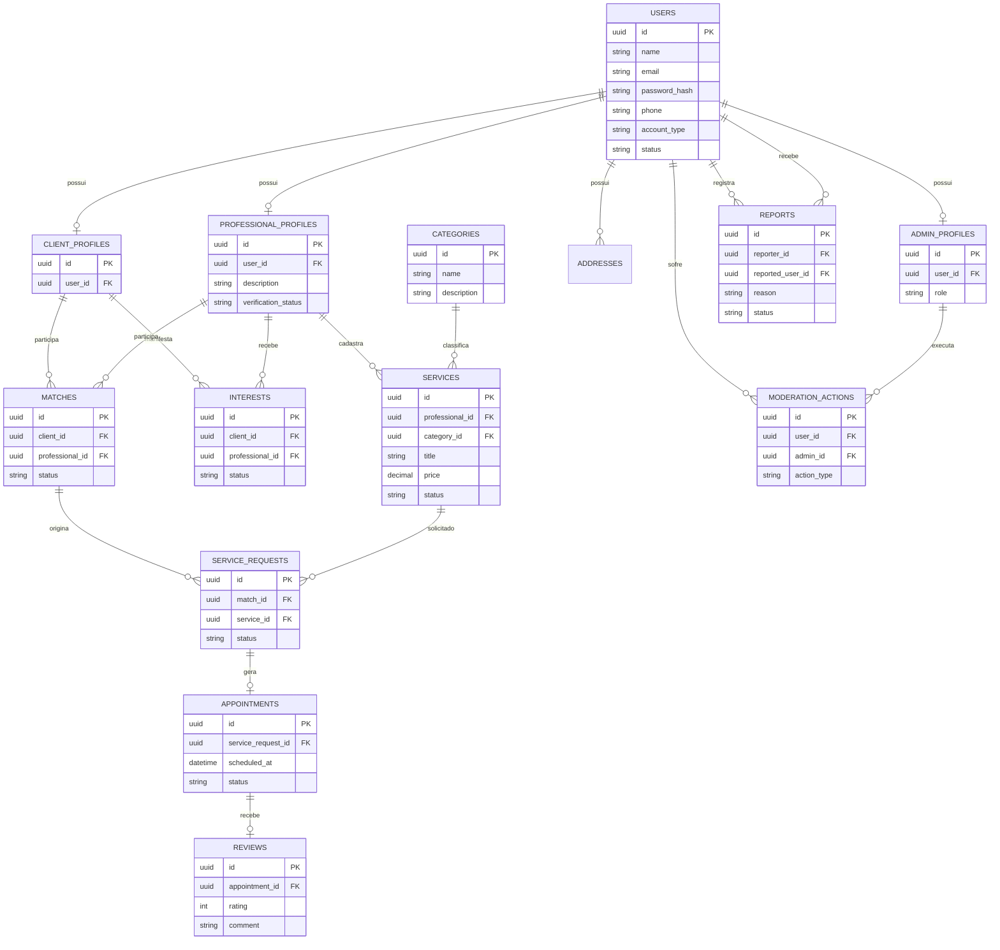

# 11. Modelagem do Banco de Dados — Dona Chica

**Projeto:** Dona Chica  
**Documento:** Modelagem do Banco de Dados  
**Versão:** 1.0  
**Status:** Modelo conceitual em desenvolvimento

---

## 1. Objetivo

Este documento apresenta a estrutura conceitual dos dados da plataforma Dona Chica, identificando as principais entidades, seus atributos e relacionamentos.

A modelagem tem como objetivo orientar a criação do banco de dados, garantir consistência das informações e facilitar a evolução da aplicação.

O modelo apresentado ainda não representa o esquema físico definitivo. Tipos de dados, índices, restrições e detalhes de implementação serão definidos após a escolha da tecnologia de banco de dados.

## 2. Visão Geral

A Dona Chica precisa armazenar informações relacionadas a:

- Contas e autenticação.
- Perfis de clientes.
- Perfis profissionais.
- Categorias e serviços.
- Interesses e Matches.
- Solicitações e agendamentos.
- Avaliações.
- Denúncias.
- Moderação.
- Administração.

A estrutura deverá permitir que clientes e profissionais utilizem painéis distintos, mantendo uma base centralizada de informações.

## 3. Entidades Principais

### 3.1 Usuários — `users`

Armazena os dados comuns de identificação e acesso dos usuários.

Atributos previstos:

| Campo | Descrição |
|---|---|
| id | Identificador único |
| name | Nome do usuário |
| email | E-mail de acesso |
| password_hash | Senha armazenada de forma protegida |
| phone | Telefone |
| account_type | Tipo de conta: cliente ou profissional |
| status | Situação da conta |
| created_at | Data de criação |
| updated_at | Data de atualização |

Cada usuário possuirá um único tipo de conta na plataforma.

### 3.2 Clientes — `client_profiles`

Armazena informações complementares dos usuários com conta de cliente.

| Campo | Descrição |
|---|---|
| id | Identificador do perfil |
| user_id | Referência ao usuário |
| address_id | Referência ao endereço, quando aplicável |
| created_at | Data de criação |
| updated_at | Data de atualização |

### 3.3 Profissionais — `professional_profiles`

Armazena informações específicas dos profissionais.

| Campo | Descrição |
|---|---|
| id | Identificador do perfil |
| user_id | Referência ao usuário |
| description | Apresentação profissional |
| experience | Experiências e qualificações |
| verification_status | Situação da verificação |
| profile_status | Situação de publicação |
| created_at | Data de criação |
| updated_at | Data de atualização |

Um profissional poderá disponibilizar diferentes serviços e atuar em mais de uma categoria.

### 3.4 Endereços — `addresses`

Armazena informações de localização relacionadas aos usuários ou aos atendimentos, conforme as regras de privacidade definidas.

| Campo | Descrição |
|---|---|
| id | Identificador |
| postal_code | CEP |
| state | Estado |
| city | Cidade |
| neighborhood | Bairro |
| street | Logradouro |
| number | Número |
| complement | Complemento |
| created_at | Data de criação |

O acesso aos endereços deverá respeitar as permissões e a finalidade de utilização.

### 3.5 Categorias — `categories`

Organiza os tipos de serviços disponíveis.

| Campo | Descrição |
|---|---|
| id | Identificador |
| name | Nome da categoria |
| description | Descrição |
| status | Situação da categoria |
| created_at | Data de criação |

Exemplos de categorias:

- Serviços domésticos.
- Manutenção e reparos.
- Culinária.
- Atividades criativas.
- Serviços religiosos e esotéricos.

### 3.6 Serviços — `services`

Armazena os serviços disponibilizados pelos profissionais.

| Campo | Descrição |
|---|---|
| id | Identificador |
| professional_id | Referência ao perfil profissional |
| category_id | Referência à categoria |
| title | Nome do serviço |
| description | Descrição |
| price | Preço informado |
| status | Situação do serviço |
| created_at | Data de criação |
| updated_at | Data de atualização |

Um profissional poderá cadastrar vários serviços.

### 3.7 Interesses — `interests`

Registra as manifestações de interesse entre clientes e profissionais.

| Campo | Descrição |
|---|---|
| id | Identificador |
| client_id | Cliente interessado |
| professional_id | Profissional relacionado |
| status | Situação do interesse |
| created_at | Data de criação |

Essa entidade será utilizada como base para o funcionamento do sistema de Match.

As regras para registrar, cancelar e expirar interesses deverão ser definidas posteriormente.

### 3.8 Matches — `matches`

Armazena as conexões estabelecidas a partir da reciprocidade de interesse.

| Campo | Descrição |
|---|---|
| id | Identificador |
| client_id | Cliente relacionado |
| professional_id | Profissional relacionado |
| status | Situação do Match |
| created_at | Data de criação |
| updated_at | Data de atualização |

Um Match deverá representar uma conexão confirmada entre as duas partes.

A estrutura definitiva dependerá das regras de reciprocidade e dos critérios de formação do Match.

### 3.9 Solicitações — `service_requests`

Armazena as solicitações de serviços realizadas pelos clientes.

| Campo | Descrição |
|---|---|
| id | Identificador |
| match_id | Referência ao Match |
| client_id | Cliente solicitante |
| professional_id | Profissional solicitado |
| service_id | Serviço desejado |
| description | Detalhes da solicitação |
| status | Situação da solicitação |
| created_at | Data de criação |
| updated_at | Data de atualização |

A solicitação deverá permitir o acompanhamento de seu estado, como pendente, aceita, recusada ou cancelada.

### 3.10 Agendamentos — `appointments`

Armazena informações relacionadas à realização dos serviços.

| Campo | Descrição |
|---|---|
| id | Identificador |
| service_request_id | Referência à solicitação |
| scheduled_at | Data e horário previstos |
| completed_at | Data de conclusão |
| status | Situação do atendimento |
| created_at | Data de criação |
| updated_at | Data de atualização |

Os estados e regras de alteração dos agendamentos serão detalhados posteriormente.

### 3.11 Avaliações — `reviews`

Armazena as avaliações registradas após os atendimentos.

| Campo | Descrição |
|---|---|
| id | Identificador |
| appointment_id | Atendimento relacionado |
| client_id | Cliente responsável |
| professional_id | Profissional avaliado |
| rating | Nota atribuída |
| comment | Comentário |
| created_at | Data de criação |

As avaliações deverão estar associadas a atendimentos válidos, evitando registros sem relação com uma experiência real na plataforma.

### 3.12 Denúncias — `reports`

Armazena ocorrências relatadas pelos usuários.

| Campo | Descrição |
|---|---|
| id | Identificador |
| reporter_id | Usuário responsável pela denúncia |
| reported_user_id | Usuário denunciado |
| appointment_id | Atendimento relacionado, quando aplicável |
| reason | Motivo |
| description | Descrição da ocorrência |
| status | Situação da análise |
| created_at | Data de registro |
| updated_at | Data de atualização |

As denúncias deverão possuir estados que permitam acompanhar o processo de análise e sua conclusão.

### 3.13 Registros de Moderação — `moderation_actions`

Armazena as decisões e medidas administrativas aplicadas aos usuários.

| Campo | Descrição |
|---|---|
| id | Identificador |
| user_id | Usuário afetado |
| admin_id | Administrador responsável |
| report_id | Denúncia relacionada, quando aplicável |
| action_type | Tipo de medida |
| reason | Justificativa |
| started_at | Início da medida |
| ends_at | Fim da medida, quando aplicável |
| created_at | Data do registro |

Essa entidade permitirá documentar medidas como advertências, suspensões e aplicação do Ghost Mode.

A aplicação de medidas deverá considerar análise e critérios de moderação, não apenas a contagem automática de denúncias.

### 3.14 Administradores — `admin_profiles`

Armazena informações complementares dos usuários com permissões administrativas.

| Campo | Descrição |
|---|---|
| id | Identificador |
| user_id | Referência ao usuário |
| role | Perfil de permissão |
| created_at | Data de criação |

O acesso administrativo deverá ser restrito e controlado.

---

## 4. Relacionamento entre as Entidades

Os relacionamentos conceituais previstos são:

- Um usuário possui um único tipo de conta.
- Um usuário cliente possui um perfil de cliente.
- Um usuário profissional possui um perfil profissional.
- Um profissional pode cadastrar vários serviços.
- Uma categoria pode possuir vários serviços.
- Um cliente pode manifestar interesse em diferentes profissionais.
- Um profissional pode receber interesses de diferentes clientes.
- A reciprocidade de interesse poderá originar um Match.
- Um Match poderá estar relacionado a solicitações de serviço, conforme as regras definidas.
- Uma solicitação poderá originar um agendamento.
- Um atendimento concluído poderá receber uma avaliação.
- Um usuário poderá registrar denúncias.
- Uma denúncia poderá gerar uma análise e uma medida de moderação.
- Um administrador poderá realizar diferentes ações administrativas.

## 5. Diagrama Entidade-Relacionamento Conceitual

O diagrama representa os relacionamentos conceituais previstos. As cardinalidades e restrições definitivas deverão ser validadas durante a implementação.

## 6. Integridade e Consistência dos Dados

O banco de dados deverá adotar mecanismos para preservar a integridade das informações.

Requisitos previstos:

- Identificadores únicos para as entidades.
- Chaves estrangeiras para relacionamentos.
- Restrições de campos obrigatórios.
- Validação de e-mails.
- Controle de duplicidade de contas.
- Validação de valores e estados permitidos.
- Integridade entre solicitações e agendamentos.
- Integridade entre atendimentos e avaliações.
- Controle de registros relacionados à moderação.

## 7. Segurança e Privacidade

A estrutura de dados deverá considerar a proteção das informações pessoais.

Diretrizes:

- Não armazenar senhas em texto puro.
- Restringir acesso a informações sensíveis.
- Evitar exposição desnecessária de endereços.
- Controlar permissões por tipo de conta.
- Registrar ações administrativas relevantes.
- Definir políticas de retenção e exclusão de dados.
- Proteger informações relacionadas a denúncias.
- Avaliar os requisitos legais para dados de verificação de identidade.

A modelagem deverá ser revisada considerando os princípios e obrigações da LGPD.

## 8. Decisões Pendentes

Antes da implementação definitiva, será necessário definir:

- Tecnologia do banco de dados.
- Tipos físicos dos campos.
- Estratégia de armazenamento de imagens.
- Estrutura definitiva de endereços.
- Regras de formação e expiração do Match.
- Possibilidade de múltiplas solicitações por Match.
- Regras de cancelamento.
- Histórico de alterações de status.
- Política de exclusão e anonimização.
- Estrutura de auditoria.
- Estratégia de armazenamento de dados de verificação.

## 9. Evolução da Modelagem

A modelagem poderá ser atualizada conforme novas necessidades forem identificadas durante o desenvolvimento.

Toda alteração estrutural deverá considerar:

- Impacto nas funcionalidades existentes.
- Integridade dos dados.
- Compatibilidade com a API.
- Necessidade de migrações.
- Impacto na aplicação web e no futuro aplicativo Android.

## 10. Relação com Outros Documentos

- `01-visao-do-produto.md`
- `02-pesquisa-de-campo.md`
- `03-regras-de-negocio.md`
- `04-personas.md`
- `05-requisitos-funcionais.md`
- `06-requisitos-nao-funcionais.md`
- `07-escopo-do-mvp.md`
- `08-fluxos-de-usuario.md`
- `09-arquitetura-do-produto.md`
- `10-arquitetura-tecnica.md`

---

**Dona Chica — Documentação Técnica**
